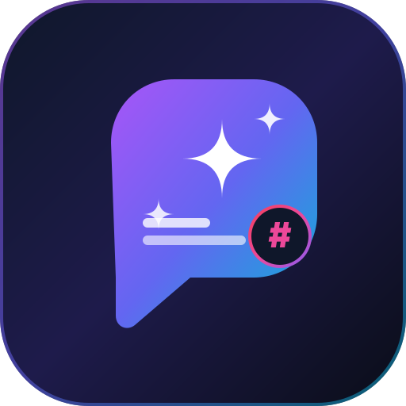

# 🚀 CaptionGenius AI - Social Media Caption & Hook Generator

> **Professional AI-powered social media caption generator built for creators in Sri Lanka 🇱🇰 and worldwide.**  
> Supports **English**, **Sinhala (සිංහල)**, and **Tamil (தமிழ்)** across **TikTok**, **Instagram**, **Facebook**, and **YouTube**.



---

## ✨ Highlights & Features

- **🎯 4 Social Media Platforms**:
  - **TikTok**: High-energy opening hooks, sound cues (`[🎵 Trending Sound Cue]`), punchy text, high-velocity hashtag cloud.
  - **Instagram**: Aesthetic line-breaks, storytelling, carousel swipe cues, save & share prompts, curated hashtag clusters.
  - **Facebook**: Conversational openers, engaging narrative, question prompts for comments, share call-to-actions.
  - **YouTube**: SEO video title recommendations, full video description, structured timestamp format (`0:00 Intro`, `0:45 Key Tip`), subscriber CTA.
- **🇱🇰 3 Languages**:
  - **English**: Global reach, crisp syntax, creator best practices.
  - **Sinhala (සිංහල)**: Authentic Sri Lankan colloquial expressions, viral TikTok hooks, and local hashtags (`#srilanka #sinhala #lka #tiktok_srilanka #ceylon`).
  - **Tamil (தமிழ்)**: Native Tamil creator hooks, engaging community questions, and popular regional hashtags (`#srilanka #tamil #srilankatamil #tamiltiktok #jaffna`).
- **🎭 5 Styles / Tones**:
  - 😂 **Funny & Relatable**: Sarcastic twists, witty banter, friend-tagging CTAs.
  - 💼 **Professional & Authority**: Thought leadership, 3-point frameworks, business value.
  - 🚀 **Inspirational & Hype**: Motivational powerhouse quotes, perseverance stories, energetic emojis.
  - 💖 **Romantic & Sweet**: Heartfelt poetry, aesthetic couple vibes, warm sentiment.
  - ✨ **Aesthetic & Vibe**: Minimalist poetry, moodboard spacing, soft imagery descriptions.
- **⚡ 3 Variations Per Generation**:
  - **Variation A**: Viral 3-Second Hook First
  - **Variation B**: Storytelling & Relatable Connection
  - **Variation C**: Aesthetic, Value-Dense & Hashtags Heavy
- **📋 1-Click Copy & Customization**:
  - **Copy Full Caption**: Formatted hook, body, CTA, and hashtags ready to paste.
  - **Copy Hashtags Only**: Instant tag cluster copying.
  - **Copy Hook Only**: Quick video speech intro.
  - **Inline Editing**: Click and tweak any generated caption directly before copying!
- **💾 Saved Captions & Creator Dashboard**:
  - Local favorites collection stored safely in your browser.
  - Filter by platform, language, or search keyword.
  - Export collection as `.TXT` or `.JSON`.
  - Creator analytics tracking total generations, platform distribution, and daily credit countdown.
- **🎨 Premium Dark Navy Aesthetics**:
  - Sleek midnight navy (`#080B14`), electric purple and cyan gradients, glassmorphism cards, glowing borders.
  - Dark/Light mode toggle.
- **📱 Progressive Web App (PWA)**:
  - Installable on iPhone, iPad, Android, Mac, and Windows with offline caching.

---

## 💻 How to Run on Windows

### Method 1: Instant Run (Zero Installation Required) ⭐
1. Locate the **`CaptionGenius`** folder on your computer (e.g., `c:\Users\G15\Desktop\CaptionGenius`).
2. Double-click **`index.html`**.
3. It will immediately open and run smoothly in **Microsoft Edge**, **Google Chrome**, or your default browser.
4. All features (creative generator, copy buttons, saved library, dashboard, dark/light theme) work immediately out of the box!

### Method 2: Using VS Code Live Server (Recommended for Web Developers)
1. Open the `CaptionGenius` folder in **Visual Studio Code**.
2. Install the **Live Server** extension (by Ritwick Dey) from the Extensions tab.
3. Right-click `index.html` and select **"Open with Live Server"**.
4. The app will open at `http://127.0.0.1:5500/index.html` with instant live-reload upon changes.

### Method 3: Optional Node.js & Express Backend Server
If you have Node.js installed on your Windows machine and wish to run the secure backend:
1. Open PowerShell inside the folder:
   ```powershell
   cd c:\Users\G15\Desktop\CaptionGenius
   ```
2. Install dependencies:
   ```powershell
   npm install
   ```
3. Copy `.env.example` to `.env` and optionally set your Gemini key:
   ```powershell
   copy .env.example .env
   ```
4. Start the server:
   ```powershell
   npm start
   ```
5. Open your browser at: **`http://localhost:3000`**

---

## 🤖 AI Engine Integration & Transparency

CaptionGenius AI provides two flexible modes:

### 1. Smart Creative Fallback Engine (Default - 100% Free & Offline)
- **Zero setup required.**
- Operates client-side using curated viral frameworks, platform algorithms, and authentic English, Sinhala, and Tamil hooks.
- Never sends your content to external servers. Completely private.

### 2. Live Google Gemini AI (Optional)
If you want dynamic AI-generated captions powered by Google's latest **Gemini 1.5 Flash**:
1. Click the **"⚙️ Smart Engine"** button in the top navigation bar.
2. Select **"✨ Google Gemini AI (Live API)"**.
3. Paste your free Gemini API key (get one in 60 seconds from [Google AI Studio](https://aistudio.google.com/app/apikey)).
4. Click **"Test Key"** to verify, then **"Save Settings"**.
5. *Privacy Guarantee:* Your API key is stored only inside your browser's private `localStorage` and communicates directly with Google's API. It is never exposed or uploaded anywhere else.

---

## 🌐 How to Publish 100% Free

You can make your CaptionGenius app available on the internet with a public `https://` link in under 2 minutes for **$0**:

### Option A: Netlify Drop (Fastest - 30 Seconds, No Code Needed)
1. Go to [app.netlify.com/drop](https://app.netlify.com/drop).
2. Sign in or create a free account.
3. Drag and drop the **`CaptionGenius`** folder into the browser window.
4. Netlify will deploy it in seconds and give you a free live URL (e.g., `https://captiongenius.netlify.app`).

### Option B: Vercel (Fast & Supports Serverless Backend)
1. Create a free account at [Vercel.com](https://vercel.com).
2. Push your project to a GitHub repository or drag and drop using the Vercel CLI (`npx vercel`).
3. If using `api/generate.js`, add `GEMINI_API_KEY` to the Environment Variables settings in the Vercel project dashboard.
4. Click **Deploy**. Your app is live with automatic global CDN and HTTPS!

### Option C: GitHub Pages
1. Push this folder to a GitHub repository.
2. In your repo, go to **Settings** > **Pages**.
3. Under *Branch*, select **`main`** and folder **`/(root)`**, then click **Save**.
4. In 1 minute, your site will be live at `https://<your-username>.github.io/<repo-name>/`.

---

## 📱 How to Install and Use on iPhone & Android

CaptionGenius AI is built as a Progressive Web App (PWA) with full offline support.

### On iPhone & iPad (iOS Safari)
1. Open your published website link (or local network IP) in **Safari** on your iPhone.
2. Tap the **Share** button at the bottom of the screen (the square with an arrow pointing upward).
3. Scroll down the share sheet and tap **"Add to Home Screen"**.
4. Name it **"CaptionGenius"** and tap **"Add"** in the top right.
5. The CaptionGenius icon will appear directly on your iPhone home screen! It opens full-screen without browser address bars, just like a native App Store app.

### On Android (Google Chrome)
1. Open your link in **Google Chrome**.
2. Tap the **"📱 Install App"** button in our header navigation bar, or tap the Chrome three-dot menu (⋮) > **"Install App"** / **"Add to Home screen"**.
3. Confirm installation. The app will install onto your app drawer and home screen.

---

## 💰 Paid Services Breakdown & Cost Transparency

We maintain **100% pricing transparency**. You do **not** need to pay for anything to run or use this prototype:

| Service | Category | Cost | Required? |
| :--- | :--- | :--- | :--- |
| **Smart Creative Engine** | Built-in Engine | **$0 / Free Forever** | ✅ Included by default |
| **Google Gemini 1.5 Flash API** | AI API | **$0 Free Tier** (15 requests/min, 1,500 requests/day) | ⚪ Optional |
| **Hosting (Vercel / Netlify / GitHub Pages)** | Web Hosting | **$0 / Free Tier** | ⚪ Optional for web publishing |
| **Custom Domain (`.com` / `.lk`)** | Web Address | Optional ($10 - $30 / year) | ❌ Not required (free subdomains work) |

> ⚠️ **Notice**: Antigravity and this application will never automatically purchase, subscribe to, or bill you for any paid services.

---

## 📁 Project File Structure

```text
CaptionGenius/
├── index.html            # Semantic HTML5 app, SEO meta, PWA headers, modals, views
├── style.css             # Vanilla CSS3 design system, dark navy theme, glassmorphism, responsive
├── script.js             # Vanilla JS state, creative fallback generator, Gemini connector, PWA
├── manifest.json         # PWA Manifest for mobile & desktop installation
├── sw.js                 # Service Worker for offline capability & asset caching
├── package.json          # Node.js dependencies configuration for optional backend
├── server.js             # Optional Express backend proxy
├── .env.example          # Environment variables template
├── api/
│   └── generate.js       # Vercel / Netlify serverless function for server-side API proxy
├── icons/
│   ├── icon.svg          # High-resolution vector logo
│   ├── icon-192.svg      # 192x192 PWA icon
│   └── icon-512.svg      # 512x512 PWA icon
└── README.md             # Beginner-friendly guide and documentation
```

---

## 🇱🇰 Tailored for Creators in Sri Lanka & Worldwide

Whether you are a food vlogger in Colombo, a travel creator showcasing Ella's tea country, a business owner in Jaffna, or an international TikTok creator, **CaptionGenius AI** is built to help you grow your audience with engaging captions and viral hooks!
